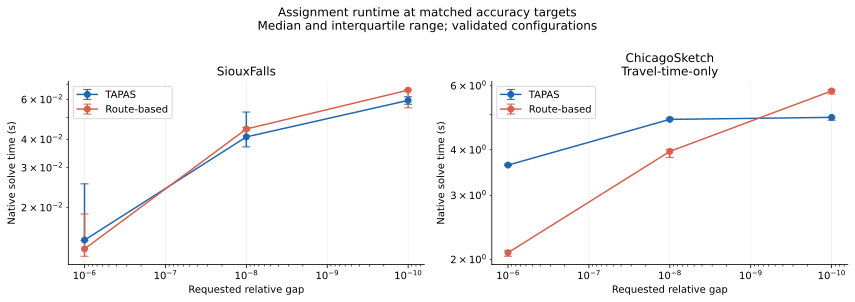

# TrafficAssignmentApproaches

**C++20 · Python · Graph algorithms · Bilevel optimization**

Predict how traffic distributes across a road network, then optimize road
capacities under an investment budget while accounting for how drivers reroute.
TrafficAssignmentApproaches combines numerical algorithms with a reusable
C++ library, a Python API, and reproducible computational experiments.

The project grew out of graduate research at Saint Petersburg State University.

[Benchmark study](docs/benchmarks/README.md) ·
[Quick start](#quick-start) ·
[Related publication](#related-publication) ·
[Architecture](docs/architecture.md) ·
[User guide](docs/usage.md)

## What the project implements

- **Equilibrium assignment:** TAPAS with paired alternative segments and
  route-based assignment with Newton flow redistribution and parallel
  shortest-path searches.
- **Capacity optimization:** a bilevel model that repeatedly solves traffic
  assignment while allocating a limited investment budget. Optimizers include
  NLopt methods, optimality-condition updates, and gradient-based pipelines.
- **One computation core:** the C++ library, Python bindings, and command-line
  applications share the same implementation. NumPy result arrays are independent
  snapshots; pandas input adapters are optional.
- **Numerical validation:** analytic examples, native and Python tests, and
  independent benchmark checks for flow conservation, equilibrium accuracy,
  investment, and capacity bounds.

## Measured results

The [benchmark study](docs/benchmarks/README.md) compares both assignment methods
at three accuracy targets, measures route-search scaling with 1–8 threads, and
evaluates a capacity-expansion scenario. Inputs come from a pinned revision of
[Transportation Networks for Research](https://github.com/bstabler/TransportationNetworks).

On an Intel Core i7-13650HX with a GCC 15.2 Release build:

| Study result | Measured outcome |
| --- | --- |
| Assignment scale | Chicago Sketch: **933 nodes, 2,950 links, 93,135 interzonal OD pairs** |
| Accuracy | Both solvers met requested relative gaps down to **1e-10** on both networks |
| Chicago Sketch runtime | **3.959 s** for route-based assignment at target gap 1e-8; median of five runs |
| Capacity optimization | **17.30% lower simulated travel time** on Sioux Falls, within the investment budget and capacity bounds |
| Validation | **78/78 measured runs passed**, plus 16 successful warm-ups |

Parallel route search gave 0.90×, 0.96×, and 1.02× whole-solve speedups with
2, 4, and 8 threads respectively. The eight-thread and serial timing ranges
overlap; this workload shows little overall benefit from additional threads.



The report includes all repetitions, validation results, machine/build details,
input checksums, and commands to regenerate its tables and figures. Chicago Sketch
uses a **travel-time-only** model; Sioux Falls is a small research benchmark.
Capacity-optimization results describe simulated outcomes under the stated
investment assumptions.

## Quick start

Requires **Python 3.11+**, a **C++20** compiler, and **CMake 3.24+**.
On Ubuntu/Debian, install the native prerequisites:

```bash
sudo apt install build-essential cmake ninja-build pkg-config git \
                 libeigen3-dev libnlopt-cxx-dev libboost-all-dev \
                 python3-dev python3-venv
python3 -m venv .venv
source .venv/bin/activate
python -m pip install -e .
```

The first build downloads pinned native dependencies. From the repository root,
solve a network with two competing routes; no dataset download is needed:

```python
import traffic_assignment as ta

network = ta.network_from_arrays(
    "TwoRoutes",
    init_node=[0, 0, 2], term_node=[1, 2, 1],
    capacity=10.0, free_flow_time=[2.0, 1.0, 1.0],
    b=1.0, power=1.0, demand=[[0.0, 10.0], [0.0, 0.0]],
    n_nodes=3,
)
assignment = ta.solve_tap(network)
print(assignment.flows)              # [5. 5. 5.]
print(assignment.total_travel_time)  # 30.0

constraints = ta.constraints_from_arrays(network, lower=10.0, upper=20.0)
design = ta.solve_cndp(
    network,
    [ta.step("nlopt", algorithm="LN_COBYLA", max_iterations=100)],
    constraints=constraints, theta=0.1, budget=2.0,
)
print(design.capacities)
print(design.total_travel_time)
```

Solvers update the supplied network; construct a fresh network for independent
scenarios. Results expose numerical metrics for checking convergence and
feasibility. See the [full Python examples](docs/usage.md#python-quick-start) and
[model definition](docs/usage.md#problems-and-methods).

For DataFrame workflows and visualization, install `pip install -e '.[examples]'`
and open the self-contained [Sioux Falls assignment](examples/siouxfalls_tap.ipynb)
or [capacity optimization](examples/siouxfalls_cndp.ipynb) notebook.

## Related publication

Alexander Krylatov, **Maksim Korol**, and Anastasiya Raevskaya.
**[Equilibration Operators for Accurate Traffic Flow Assignment in Urban Road Networks](https://doi.org/10.1007/978-3-031-70300-3_39)**.
In *Cybernetics and Control Theory in Systems*, CSOC 2024,
Lecture Notes in Networks and Systems, vol. 1119, pp. 526–535.
Springer, 2024. [BibTeX](docs/references.bib).

This coauthored publication studies equilibration operators for accurate
traffic assignment. It provides related research context; the benchmark study
in this repository evaluates the current software independently.

## Reproduce the study

```bash
python -m pip install -e '.[examples,test]' -Ccmake.build-type=Release

# Short installation and numerical-validation check.
python scripts/run_benchmarks.py --profile quick \
  --output performance_results/benchmark-quick

# Full study: repeated measurements, with a one-hour worker budget.
python scripts/run_benchmarks.py --profile full --time-budget 3600 \
  --output performance_results/benchmark-full

# Regenerate the report and figures from saved measurements.
python scripts/run_benchmarks.py --render-only performance_results/benchmark-full
```

The runner retrieves pinned source inputs and caches them separately from existing
datasets. With a local TransportationNetworks Git clone, add
`--source-root data/TransportationNetworks` to prepare inputs offline.
See the [study methodology](docs/benchmarks/README.md#methodology-and-validation)
for timing boundaries, validation criteria, and limitations.

## Documentation and development

| Guide | Contents |
| --- | --- |
| [User guide](docs/usage.md) | Models, native installation, Python/C++ usage, configuration, and experiment tools |
| [Architecture](docs/architecture.md) | Shared core, bindings, ownership, precision, and implementation limits |
| [Solver inputs](docs/inputs.md) | Numerical contracts, CSV formats, and indexing |
| [DataFrame inputs](docs/dataframes.md) | pandas adapters, label alignment, and capacity constraints |
| [Benchmark evidence](docs/benchmarks/README.md#evidence) | Raw measurements, summaries, configurations, and provenance |

```bash
python -m pip install -e '.[test]'
python -m pytest tests/

cmake --preset linux-release -DBUILD_NATIVE_TESTS=ON
cmake --build --preset build-release
ctest --test-dir build/linux-release --output-on-failure
```

The public C++ API is under `cpp/include/traffic_assignment/`, Python adapters
under `python/traffic_assignment/`, and standalone applications under `cpp/apps/`.
