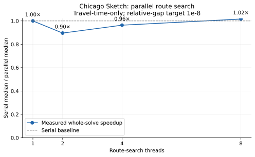
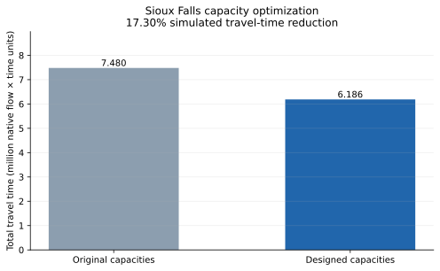

# Traffic assignment benchmark study

Measured 2026-10-13 · **full profile** · 168/168 measured runs passed validation.

This study compares the repository's implementations under identical inputs and requested accuracy. Results apply to this machine and build. External solver comparisons and global CNDP optimality are outside this study.

## Inputs and model

| Dataset | Nodes | Links | Interzonal OD pairs | Modeled demand | Road-network demand |
| --- | ---: | ---: | ---: | ---: | ---: |
| SiouxFalls | 24 | 76 | 528 | 360,600.00 | 360,600.00 |
| ChicagoSketch | 933 | 2950 | 93135 | 1,260,907.44 | 1,137,493.44 |
| Anaheim | 416 | 914 | 1406 | 104,694.40 | 104,694.40 |
| Sydney | 33113 | 75379 | 123370 | 480,515.00 | 411,949.00 |

Source: [Transportation Networks for Research](https://github.com/bstabler/TransportationNetworks/tree/375e0da93858c547230c5cf9ea8a96de4ccff29e). Exact revision and input checksums are in [manifest.json](manifest.json). Fractional demand is preserved except for the explicitly identified Sydney variant. Intrazonal trips remain in the input as zero-link trips; they contribute no road flow or travel time. Road-network demand excludes them.

The selected networks use BPR travel-time costs and allow transit through every node. **Chicago Sketch is a travel-time-only variant**: toll and distance terms from the published generalized-cost reference are excluded, so its published reference objective does not apply here. Sioux Falls is a small research/debugging benchmark. Travel-time totals retain native dataset units.

**Anaheim uses unrestricted transit and fractional source demand.** This project-specific variant allows intermediate zone nodes; published reference objectives for restricted routing do not apply.

**Sydney uses unrestricted transit and CSV-compatible truncated demand.** Every nonnegative source OD value is rounded down, reproducing the existing CSV-based `scripts/run_experiment.py tap --dataset Sydney` workload. The study measures native solve time with statistics disabled, so timings are not directly comparable to that command's elapsed time. Source critical-speed and lane columns are not interpreted as tolls or link types.

Sydney's source header declares 849,339 trips; its entries sum to 854,772.126000. The modeled total after truncation is 480,515, including 68,566 intrazonal trips. No demand rescaling is applied. The known header discrepancy is accepted only for the checksum-verified source. Results describe this modified workload, not the original full-demand reference case.

## Assignment accuracy and runtime

Times are medians with 25th–75th percentiles, in seconds. Statistics use successful measured runs; the count exposes incomplete configurations. Warm-ups are excluded.

| Dataset | Method | Target gap | Successful runs | Median [Q25, Q75] (s) | Max achieved gap |
| --- | --- | ---: | ---: | ---: | ---: |
| SiouxFalls | tapas | 1e-06 | 5/5 | 0.0137 [0.0136, 0.0139] | 6.41e-07 |
| SiouxFalls | routebased | 1e-06 | 5/5 | 0.0112 [0.0111, 0.0114] | 9.07e-07 |
| SiouxFalls | tapas | 1e-08 | 5/5 | 0.0350 [0.0349, 0.0352] | 2.85e-10 |
| SiouxFalls | routebased | 1e-08 | 5/5 | 0.0328 [0.0327, 0.0331] | 4.11e-09 |
| SiouxFalls | tapas | 1e-10 | 5/5 | 0.0514 [0.0511, 0.0528] | 1.67e-12 |
| SiouxFalls | routebased | 1e-10 | 5/5 | 0.0501 [0.0498, 0.0511] | 6.42e-11 |
| ChicagoSketch | tapas | 1e-06 | 5/5 | 3.3744 [3.2925, 3.4214] | 1.70e-07 |
| ChicagoSketch | routebased | 1e-06 | 5/5 | 1.8308 [1.7039, 1.8439] | 9.97e-08 |
| ChicagoSketch | tapas | 1e-08 | 5/5 | 4.6242 [4.4706, 4.6265] | 2.76e-18 |
| ChicagoSketch | routebased | 1e-08 | 5/5 | 3.3392 [3.1750, 3.3718] | 2.75e-10 |
| ChicagoSketch | tapas | 1e-10 | 5/5 | 4.5238 [4.4405, 4.5878] | 2.76e-18 |
| ChicagoSketch | routebased | 1e-10 | 5/5 | 4.9054 [4.6624, 5.0697] | 6.13e-12 |
| Anaheim | tapas | 1e-06 | 5/5 | 0.0252 [0.0251, 0.0254] | 4.66e-18 |
| Anaheim | routebased | 1e-06 | 5/5 | 0.0471 [0.0471, 0.0473] | 3.73e-13 |
| Anaheim | tapas | 1e-08 | 5/5 | 0.0255 [0.0251, 0.0256] | 4.66e-18 |
| Anaheim | routebased | 1e-08 | 5/5 | 0.0476 [0.0463, 0.0481] | 3.73e-13 |
| Anaheim | tapas | 1e-10 | 5/5 | 0.0252 [0.0251, 0.0254] | 4.66e-18 |
| Anaheim | routebased | 1e-10 | 5/5 | 0.0475 [0.0463, 0.0477] | 3.73e-13 |
| Sydney | tapas | 1e-06 | 5/5 | 20.8219 [18.9370, 23.6171] | 2.94e-07 |
| Sydney | routebased | 1e-06 | 5/5 | 31.8278 [29.3686, 34.3806] | 5.08e-15 |
| Sydney | tapas | 1e-08 | 5/5 | 76.2551 [71.3386, 78.0186] | 2.66e-18 |
| Sydney | routebased | 1e-08 | 5/5 | 29.0705 [27.4067, 30.5965] | 5.08e-15 |
| Sydney | tapas | 1e-10 | 5/5 | 72.4882 [70.3949, 79.7915] | 2.66e-18 |
| Sydney | routebased | 1e-10 | 5/5 | 28.7894 [28.5074, 30.0778] | 5.08e-15 |


## Parallel route-search scaling

Route-based solver, target relative gap 1e-8, with a separate serial baseline for each network. Speedup measures the entire solve: flow redistribution remains sequential. Speedups below 1 indicate a slowdown. Only fully validated configurations with matching travel-time and Beckmann objectives receive a speedup.

| Dataset | Threads | Successful runs | Median [Q25, Q75] (s) | Speedup |
| --- | ---: | ---: | ---: | ---: |
| Anaheim | 1 | 5/5 | 0.0476 [0.0463, 0.0481] | 1.00× |
| Anaheim | 2 | 5/5 | 0.0461 [0.0423, 0.0474] | 1.03× |
| Anaheim | 4 | 5/5 | 0.0361 [0.0360, 0.0362] | 1.32× |
| Anaheim | 8 | 5/5 | 0.0339 [0.0337, 0.0345] | 1.40× |
| ChicagoSketch | 1 | 5/5 | 3.3392 [3.1750, 3.3718] | 1.00× |
| ChicagoSketch | 2 | 5/5 | 3.8871 [3.8445, 3.9194] | 0.86× |
| ChicagoSketch | 4 | 5/5 | 3.6186 [3.5119, 3.6523] | 0.92× |
| ChicagoSketch | 8 | 5/5 | 3.4228 [3.3616, 3.4515] | 0.98× |
| Sydney | 1 | 5/5 | 29.0705 [27.4067, 30.5965] | 1.00× |
| Sydney | 2 | 5/5 | 15.8217 [15.6770, 15.9249] | 1.84× |
| Sydney | 4 | 5/5 | 9.6293 [9.5962, 9.6737] | 3.02× |
| Sydney | 8 | 5/5 | 6.4927 [6.3748, 6.5146] | 4.48× |



## Capacity-optimization case

Sioux Falls with COBYLA, at most 500 objective evaluations, optimizer tolerance 1e-4, and TAPAS at relative gap 1e-8. Original capacities are lower bounds; upper bounds are 1.5 times those values. The illustrative investment model uses theta = 5 and budget = 100000. The objective combines equilibrium travel time and investment.

Validated measured runs: **3/3**. The designed travel time below comes from a fresh equilibrium solve at the final capacities.

| Measurement | Median |
| --- | ---: |
| Baseline total travel time | 7,480,225.310 |
| Designed total travel time | 6,186,386.519 |
| Simulated travel-time reduction | 17.30% |
| Investment used | 100,000.000 / 100,000 |
| Upper-level objective | 6,286,386.519 |
| Optimization time | 3.6519 s |
| Maximum budget violation across valid runs | 0.00e+00 |
| Maximum capacity-bound violation across valid runs | 0.00e+00 |



## Methodology and validation

- Each configuration receives one unmeasured warm-up. Full-profile TAP configurations have five measured repetitions; CNDP has three. Quick-profile configurations have one. Configuration order rotates across repetitions.
- Workers execute sequentially in fresh processes and construct fresh networks. Native computation time excludes imports, input loading, solver construction, result validation, and plotting. CNDP time includes its lower-level solves but excludes the separate baseline and fresh final-design validation.
- Statistics recording is disabled. TAPAS uses its existing seed of 42. Repeated runs measure timing variability, rather than variation across seeds.
- Independent Python checks cover finite/nonnegative flows, node conservation, BPR link costs, total travel time, and a Dijkstra-based equilibrium gap. Backend: SciPy directed Dijkstra; 64 origins per batch; minimum parallel-link cost. Gap validation allows an absolute 1e-12 roundoff margin.
- CNDP also checks capacity bounds, investment accounting, and a fresh final equilibrium. Budget tolerance is 1e-6 and bound tolerance is 1e-7. Fresh and warm-started travel times must agree within 1e-5 relative tolerance.
- TAP has a 1000-iteration ceiling. Worker limits, including validation: SiouxFalls TAP 120s, ChicagoSketch TAP 120s, Anaheim TAP 120s, Sydney TAP 600s; CNDP 300s. This run's worker budget is 14400s. Errors, timeouts, and unrun cases remain in raw results.
- Measurements follow the capacity-dependent derivative-cache correction. CNDP results describe simulated outcomes under the specified model.

## Machine and build

- CPU: 13th Gen Intel(R) Core(TM) i7-13650HX; 20 CPUs available to the process.
- Platform: Linux-7.0.0-22-generic-x86_64-with-glibc2.43.
- Compiler: x86_64-linux-gnu-g++ (Ubuntu 15.2.0-16ubuntu1) 15.2.0.
- Build: Release; release flags: -O3 -DNDEBUG.
- Python: 3.14.4; NumPy: 2.4.4; SciPy: 1.18.1.
- Numerical-library thread environment: OPENBLAS_NUM_THREADS=1, OMP_NUM_THREADS=1, MKL_NUM_THREADS=1, BLIS_NUM_THREADS=1, VECLIB_MAXIMUM_THREADS=1, NUMEXPR_NUM_THREADS=1. Native route-search thread counts are configured separately.
- Git base: 3edfd5825af2e96175bfb64879f63cad4567b487; uncommitted changes present: true.
- Source fingerprint: f478be584b134e9ae9efd50f763b1d12370a9a4ab314c6c984462eb0b06ee09c.
- The manifest records individual source hashes, the native extension hash, dependency versions, and exact configurations. Runtime depends on hardware, system load, compiler, and numerical stopping behavior.

## Reproduce

From the repository root, after installing the native prerequisites in the main README:

```bash
python -m pip install -e '.[benchmarks,test]' -Ccmake.build-type=Release
python scripts/run_benchmarks.py --profile full \
  --time-budget 14400 --output performance_results/benchmark-reproduction
python scripts/run_benchmarks.py \
  --render-only performance_results/benchmark-reproduction
```

The runner downloads only the pinned TNTP inputs into build/benchmark-data. For offline preparation, add --source-root data/TransportationNetworks with a Git clone containing the pinned revision; it reads committed blobs and ignores local dataset edits. Sydney's ZIP demand is streamed and converted once into a checked array cache. Existing run directories are protected from overwrite.

A short installation check uses --profile quick. Regenerating reports needs the plotting dependencies but does not execute solvers.

## Evidence

- [Raw measurements and detailed validation](measurements.jsonl)
- [Flat measurement table](measurements.csv)
- [Aggregated results](summary.csv)
- [Configuration and provenance](manifest.json)

Recorded unsuccessful workers (including warm-ups): **0**.
